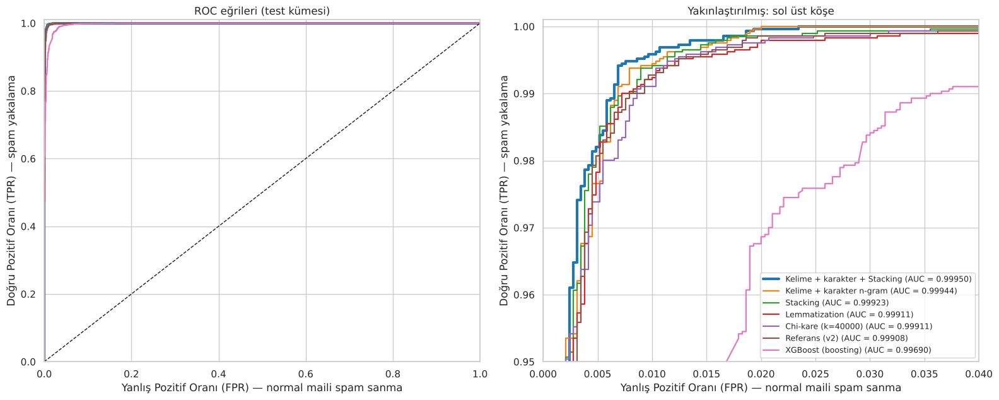
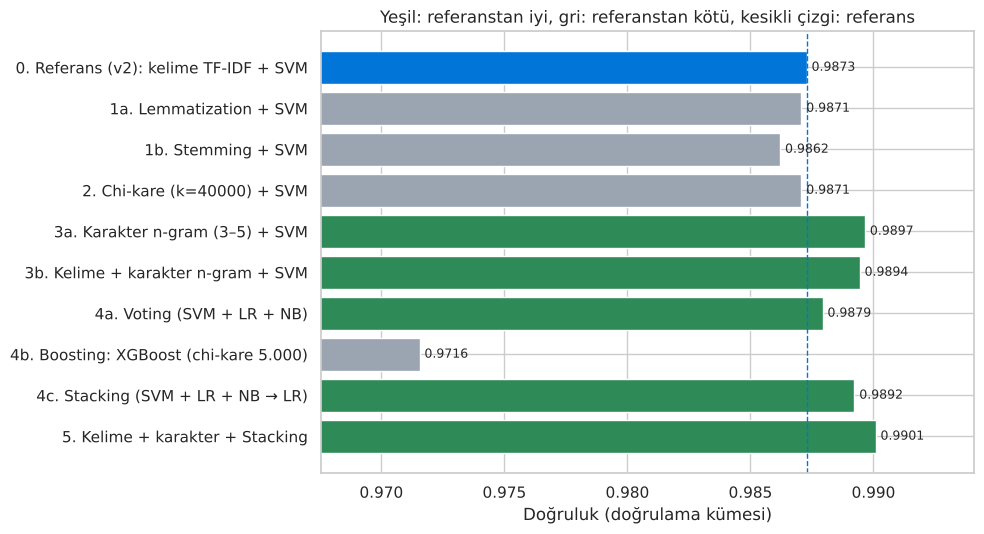
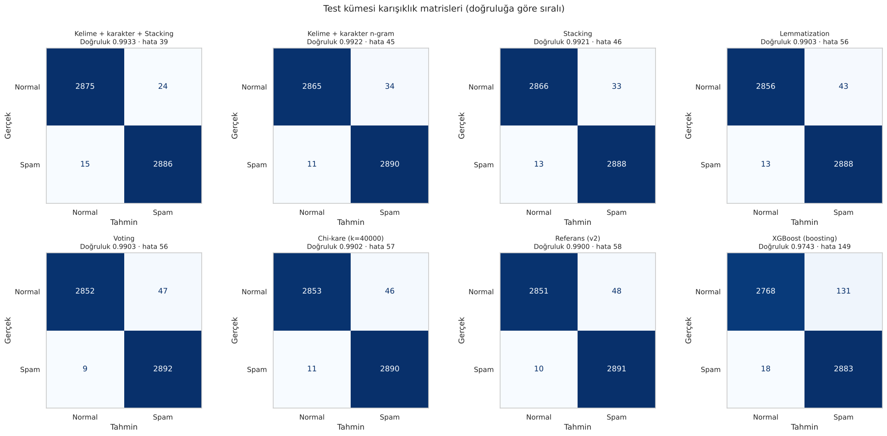

# Spam E-posta Tespiti

Enron-Spam veri setindeki 33.716 gerçek e-postayla spam ve normal e-postaları ayıran makine öğrenmesi modelleri. Çalışma üç aşamada ilerliyor: önce dört algoritma karşılaştırılıyor, sonra ölçümdeki hatalar düzeltiliyor, en sonda literatürdeki beş doğruluk artırma yöntemi aynı veride deneniyor.

Yapay Zeka dersi ödevi · Python, scikit-learn, XGBoost, NLTK, Hugging Face Transformers

**Sonuç:** Kelime ve karakter n-gram TF-IDF özellikleri üzerinde Stacking (SVM + Lojistik Regresyon + Naive Bayes) test kümesinde **%99,33 doğruluk** verdi. Referans modele göre toplam hata 58'den 39'a, normal e-postaların spam'e düşmesi 48'den 24'e indi.



## Aşamalar

| Notebook | Ne yapılıyor | Colab |
|---|---|---|
| [01 · Model karşılaştırma](notebooks/01-model-karsilastirma.ipynb) | Veri analizi, TF-IDF, Naive Bayes / Lojistik Regresyon / Doğrusal SVM / Random Forest, karışıklık matrisi, ROC, 5 katlı çapraz doğrulama | [](https://colab.research.google.com/github/MERCANX25/yapay-zeka-odev/blob/main/notebooks/01-model-karsilastirma.ipynb) |
| [02 · Ölçümü iyileştirme](notebooks/02-olcumu-iyilestirme.ipynb) | Tekrar eden e-postaları temizleme, eğitim/doğrulama/test bölmesi, GridSearchCV, eşik ayarı, hata analizi, başka veri setinde (SpamAssassin) genelleme testi | [](https://colab.research.google.com/github/MERCANX25/yapay-zeka-odev/blob/main/notebooks/02-olcumu-iyilestirme.ipynb) |
| [03 · Doğruluğu artırma](notebooks/03-dogrulugu-artirma.ipynb) | Lemmatization/stemming, chi-kare özellik seçimi, karakter n-gramları, Voting / XGBoost / Stacking, DistilBERT, ablasyon tablosu | [](https://colab.research.google.com/github/MERCANX25/yapay-zeka-odev/blob/main/notebooks/03-dogrulugu-artirma.ipynb) |

Ayrıntılı yöntem, literatür ve tartışma [proje raporunda](rapor/proje-raporu.docx).

## Sonuçlar

### 1. aşama: Algoritma karşılaştırması

| Model | Accuracy | F1 | ROC-AUC | 5 katlı CV F1 | Eğitim süresi |
|---|---|---|---|---|---|
| **Doğrusal SVM** | **0,9942** | **0,9943** | 0,9996 | 0,9909 ± 0,0011 | 0,3 sn |
| Lojistik Regresyon | 0,9939 | 0,9941 | 0,9996 | 0,9905 ± 0,0013 | 1,9 sn |
| Naive Bayes | 0,9905 | 0,9907 | 0,9992 | 0,9870 ± 0,0010 | 0,05 sn |
| Random Forest | 0,9893 | 0,9896 | 0,9987 | 0,9843 ± 0,0011 | 34,9 sn |

### 2. aşama: Dürüst ölçüm

Veri setindeki e-postaların %14'ü birden fazla kez geçiyordu. Aynı e-posta hem eğitimde hem testte bulunduğunda model onu ezberlemiş oluyor ve test sonucu olduğundan iyi görünüyor. Tekrarlar silindi, veri eğitim (18.560), doğrulama (4.640) ve test (5.800) kümelerine ayrıldı. Bundan sonraki bütün ayarlar doğrulama kümesinde seçildi, test kümesine yalnızca en sonda bir kez bakıldı.

### 3. aşama: Doğruluk artırma yöntemleri (test kümesi)

| Yöntem | Accuracy | ROC-AUC | Normal → spam (FP) | Kaçan spam (FN) | Toplam hata |
|---|---|---|---|---|---|
| **Kelime + karakter n-gram + Stacking** | **0,9933** | **0,99950** | **24** | 15 | **39** |
| Kelime + karakter n-gram + SVM | 0,9922 | 0,99944 | 34 | 11 | 45 |
| Stacking (SVM + LR + NB → LR) | 0,9921 | 0,99923 | 33 | 13 | 46 |
| Lemmatization + SVM | 0,9903 | 0,99911 | 43 | 13 | 56 |
| Voting (SVM + LR + NB) | 0,9903 | — | 47 | 9 | 56 |
| Chi-kare (k = 40.000) + SVM | 0,9902 | 0,99911 | 46 | 11 | 57 |
| Referans: kelime TF-IDF + SVM | 0,9900 | 0,99908 | 48 | 10 | 58 |
| DistilBERT (6.000 e-posta, 2 epoch, T4 GPU) | 0,9867 | 0,99867 | 44 | 33 | 77 |
| XGBoost | 0,9743 | 0,99690 | 131 | 18 | 149 |

DistilBERT sonucu Colab'daki GPU çalıştırmasından alındı. Repodaki notebook GPU olmadan kaydedildiği için o bölümün çıktısı boş.





## Çıkarımlar

- **Karakter n-gramları** tek başına en büyük katkıyı verdi. Kelime içi parçalar (ekler, kökler) modele kelime TF-IDF'inin görmediği ipuçları sağlıyor.
- **Stacking**, temel modellerin farklı hatalarını birleştirerek özellikle yanlış alarmı (FP) azalttı. Sert oylama (Voting) ise modeller çoğunlukla aynı e-postalarda yanıldığı için fark yaratmadı.
- **Lemmatization, stemming ve chi-kare** etkisiz kaldı. Literatürde fayda gösterdikleri çalışmalar birkaç yüz özellikle çalışıyordu; 60.000 özellik ve düzenlileştirilmiş SVM ile bu yöntemlerin ekleyeceği bilgi kalmıyor.
- **XGBoost** seyrek ve çok boyutlu metin özelliklerinde doğrusal modellerin belirgin şekilde gerisinde kaldı. **DistilBERT** de verinin yaklaşık üçte biriyle eğitildiği için, saniyeler içinde eğitilen TF-IDF + SVM'yi geçemedi.
- Sonuçlar yüksek göründüğü için ölçüm yöntemi önemliydi: tekrar temizliği ve ayrı doğrulama kümesi olmadan bu farkların çoğu gürültü düzeyinde kalırdı.

## Çalıştırma

En kolay yol tablodaki Colab bağlantıları: veri seti notebook içinde otomatik indiriliyor, ek kurulum gerekmiyor. DistilBERT bölümü GPU açıksa çalışıyor, değilse atlanıyor.

Yerelde çalıştırmak için (Python 3.10+):

```bash
pip install -r requirements.txt
jupyter notebook notebooks/
```

## Veri

- [Enron-Spam](https://github.com/MWiechmann/enron_spam_data) (Metsis, Androutsopoulos ve Paliouras, 2006): 33.716 e-posta, yaklaşık yarısı spam.
- [SpamAssassin Public Corpus](https://spamassassin.apache.org/old/publiccorpus/): 2. aşamada modelin başka bir veri setine genellenip genellenmediğini ölçmek için.

Veri setleri repoda bulunmuyor, notebook'lar çalışırken kaynağından indiriliyor.
